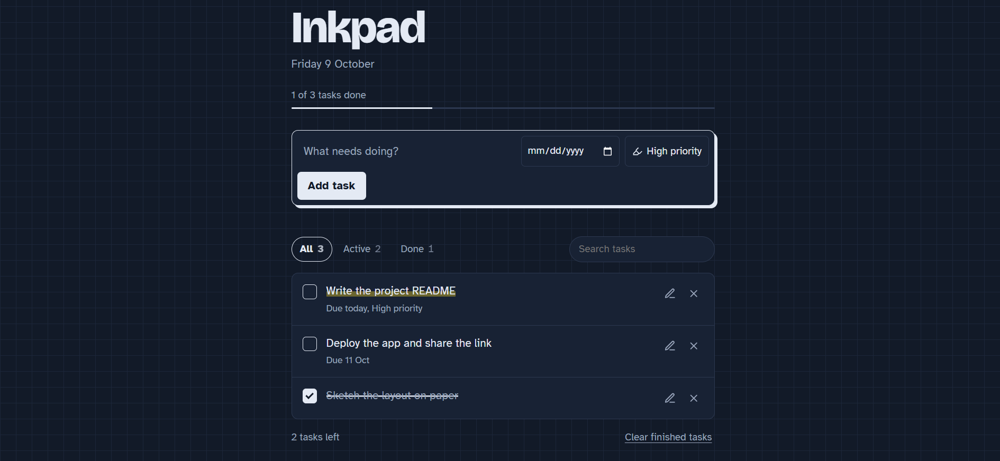

# Inkpad: Todo App

A small, fast task tracker that runs entirely in the browser. Add tasks, give them a due date or high priority, filter and search them, and tick them off. Your list is saved on your device, so it is still there when you come back.



## Features:

- **Add tasks** with an optional due date and a high-priority flag (shown as a highlighter mark).
- **Complete tasks** with the checkbox; an ink line is drawn through finished tasks.
- **Edit** a task with the pencil button or by double-clicking its title (Enter saves, Esc cancels).
- **Delete** a task, or clear all finished tasks at once, with a 5-second **Undo**.
- **Filter** by All, Active or Done, with live counts.
- **Search** tasks by title.
- **Smart ordering:** unfinished tasks first, high priority on top, then by nearest due date. Overdue tasks are flagged in red.
- **Progress bar** showing how many tasks are done.
- **Persistence** with `localStorage`, with safe fallbacks if storage is blocked.
- **Responsive, light and dark mode, keyboard accessible**, and respects reduced-motion settings.

## Tech stack:

| Layer | Choice |
| --- | --- |
| Markup | HTML5 (semantic: `main`, `form`, `ul`, labelled controls) |
| Styling | Plain CSS with custom-property design tokens |
| Logic | Vanilla JavaScript (ES5+), no framework, no build step |
| Storage | Browser `localStorage` |
| Fonts | Bricolage Grotesque (headings), Atkinson Hyperlegible (body), via Google Fonts |
| Hosting | Claude artifact (any static host works) |

## Project structure:

```
inkpad-todo/
├── index.html   # The whole app: markup, styles and script
├── README.md    # This file
└── SPEC.md      # Short project specification
```

## Run locally:

No install needed.

1. Download or clone the folder.
2. Open `index.html` in any modern browser.

Or serve it locally:

```bash
npx serve .          # or: python3 -m http.server 8000
```

## Deploy:

The app is one static file, so any static host works:

- **GitHub Pages:** push the folder to a repo, then Settings, Pages, deploy from the `main` branch.
- **Netlify:** drag and drop the folder onto app.netlify.com/drop.
- **Vercel:** run `npx vercel` in the folder.

## Data model:

Each task is stored as a JSON object under the key `inkpad.tasks.v1`:

```json
{
  "id": "lx2k9a7f3q",
  "title": "Write the project README",
  "due": "2026-10-09",
  "priority": "high",
  "done": false,
  "created": 1760000000000,
  "completed": null
}
```

## Keyboard use:

| Action | How |
| --- | --- |
| Add a task | Type in the input, press **Enter** |
| Move between controls | **Tab** / **Shift+Tab** |
| Complete a task | Focus its checkbox, press **Space** |
| Save or cancel an edit | **Enter** / **Esc** |

## Limitations and next steps:

- Tasks live in one browser on one device; there is no account or sync.
- Possible extensions: drag-and-drop reordering, multiple lists, tags, export/import as JSON, and cloud sync with a backend such as Supabase or Firebase.
